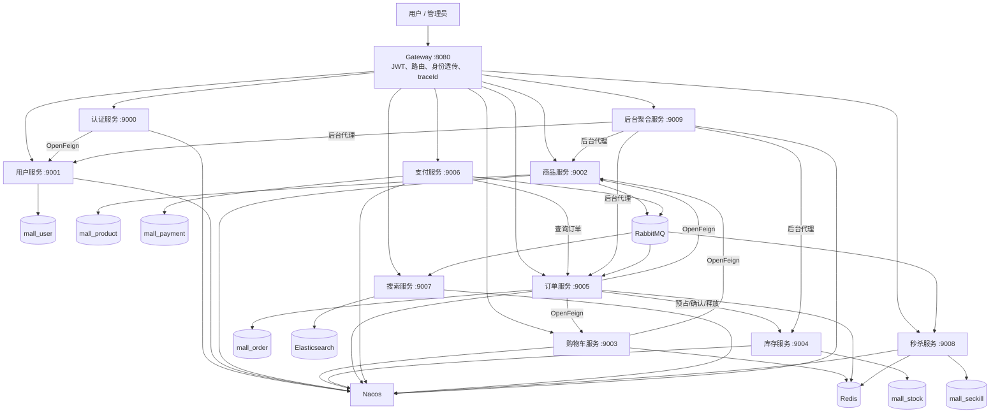
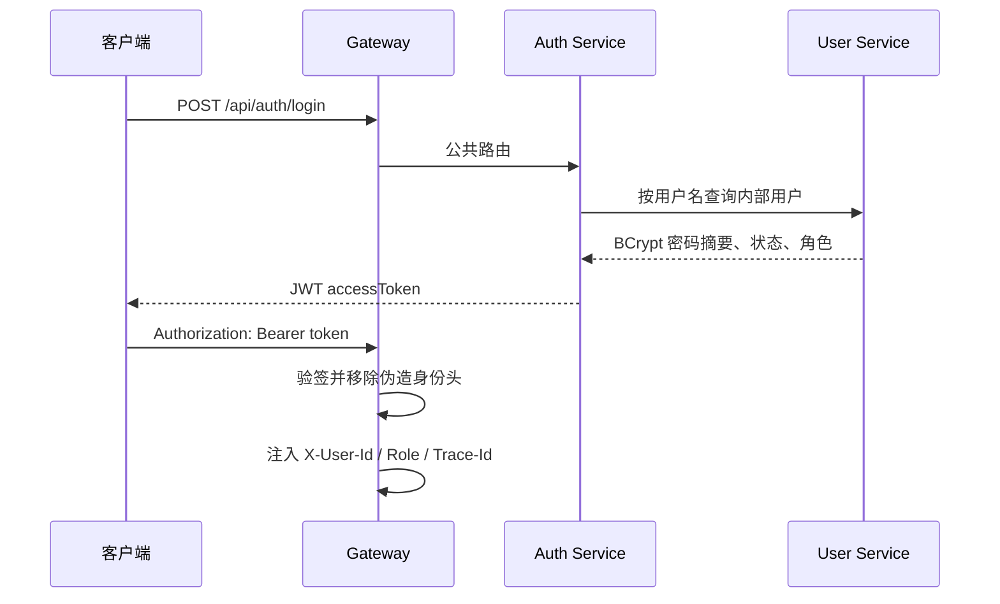
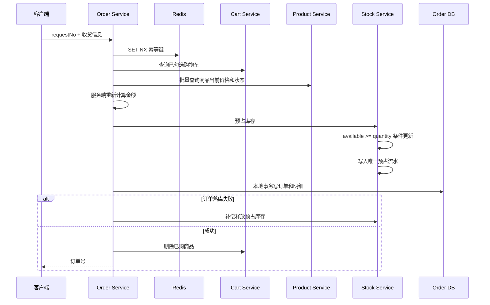
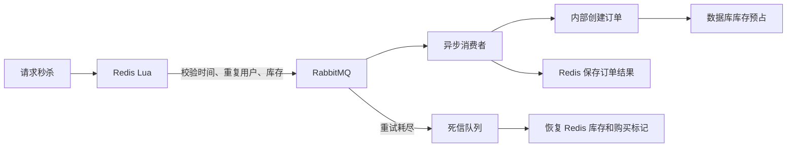

# Mall-Cloud 微服务电商平台

Mall-Cloud 是一个基于 Java 17、Spring Boot 3 和 Spring Cloud Alibaba 的企业级后端架构演示项目。它不是把多个包放进同一个进程的“伪微服务”：每个服务都能独立启动、独立注册到 Nacos，并且业务数据按服务拆分到不同数据库。

项目已经覆盖注册登录、商品、分类、Redis 购物车、订单、库存预占、模拟支付、Elasticsearch 搜索、秒杀和运营后台 API。核心实现重点是金额可信、重复请求幂等、库存不超卖、消息可重试，以及跨服务失败后的补偿。

## 1. 技术栈与版本

| 类别 | 技术 | 版本 |
|---|---|---|
| 语言 | Java | 17（也可使用更高版本 JDK 编译为 Java 17 字节码） |
| 基础框架 | Spring Boot | 3.2.12 |
| 认证授权 | Spring Security WebFlux + JWT | Spring Security 6.2.x |
| 微服务 | Spring Cloud | 2023.0.3 |
| 微服务扩展 | Spring Cloud Alibaba | 2023.0.1.2 |
| ORM | MyBatis-Plus | 3.5.7 |
| 注册中心 | Nacos | 2.4.3 |
| 数据库 | MySQL | 8.0.39 |
| 缓存 | Redis | 7.2 |
| 消息队列 | RabbitMQ | 3.13 |
| 搜索 | Elasticsearch / Kibana | 8.14.3 |
| 分布式事务组件 | Seata Server | 2.0.0（容器已提供） |

版本关系采用 Spring Boot 3.2.x + Spring Cloud 2023.0.x + Spring Cloud Alibaba 2023.0.x，避免使用基于 `javax.*` 的旧版依赖。

## 2. 系统架构



## 3. 模块职责

| 模块 | 端口 | 职责 |
|---|---:|---|
| `mall-common` | - | 统一响应、异常、JWT、用户上下文、traceId、雪花 ID |
| `mall-api` | - | Feign DTO、内部服务契约、MQ 事件契约 |
| `mall-gateway` | 8080 | 统一入口、JWT 校验、管理员鉴权、身份头防伪、路由 |
| `mall-auth-service` | 9000 | 登录、BCrypt 密码校验、JWT 签发 |
| `mall-user-service` | 9001 | 注册、个人资料、用户分页、启用/禁用 |
| `mall-product-service` | 9002 | 商品和分类 CRUD、上下架、商品变更事件 |
| `mall-cart-service` | 9003 | Redis 购物车、价格和上下架状态刷新 |
| `mall-stock-service` | 9004 | 库存预占、确认、释放、幂等流水、防超卖 SQL |
| `mall-order-service` | 9005 | 下单、服务端计价、状态机、超时取消、支付消息消费 |
| `mall-payment-service` | 9006 | 模拟支付、支付流水、Outbox 可靠事件 |
| `mall-search-service` | 9007 | Elasticsearch 索引、关键字搜索、价格排序、定时全量同步 |
| `mall-seckill-service` | 9008 | Redis Lua 扣减、MQ 异步下单、重试、死信补偿 |
| `mall-admin-service` | 9009 | 用户、商品、库存、订单后台聚合 API |

数据库之间没有跨库查询。需要其他服务的数据时，只能通过 Feign、MQ 事件或订单快照获取。

## 4. 核心业务设计

### 4.1 注册和登录



密码只保存 BCrypt 摘要。普通请求不能自行伪造 `X-User-Id`，Gateway 会先删除客户端传入的身份头，再根据 JWT 重新注入。

### 4.2 创建订单与防超卖



库存不采用“先查再改”。核心 SQL 在一条原子更新中判断库存：

```sql
UPDATE stock
SET available_stock = available_stock - :quantity,
    locked_stock = locked_stock + :quantity,
    version = version + 1
WHERE product_id = :productId
  AND available_stock >= :quantity;
```

只有受影响行数为 1 才表示预占成功。`stock_reservation(order_no, product_id)` 唯一索引保证同一订单的重复请求不会重复扣减。

### 4.3 支付最终一致性

支付服务在同一个本地事务内写支付记录和 `payment_outbox`。定时发布器发送 `payment.succeeded` 事件，失败会按退避时间继续重试。订单服务使用 `processed_message(message_id, consumer)` 唯一索引幂等消费，然后把订单改为 `PAID` 并确认锁定库存。

项目没有用 Seata AT 把所有服务强行包进一个长事务。核心链路选择“本地事务 + Outbox + 幂等消费 + 补偿”，因为它对 MQ 场景更可观察，也避免数据库全局锁持有过久。Compose 仍提供 Seata Server，便于后续对比实现需要强一致的后台业务。

### 4.4 秒杀



活动价来自秒杀数据库，不接收客户端价格。每位用户购买标记和库存扣减在同一个 Lua 脚本内完成。

## 5. Redis Key 设计

| Key | 类型 | 用途 | TTL |
|---|---|---|---|
| `mall:cart:{userId}` | Hash | 用户购物车，field 为商品 ID | 30 天 |
| `mall:order:idem:{userId}:{requestNo}` | String | 下单幂等和分布式互斥 | 处理中 10 分钟，成功 1 天 |
| `mall:seckill:stock:{activityId}` | String | 秒杀剩余库存 | 活动结束后 1 天 |
| `mall:seckill:buyers:{activityId}` | Set | 已抢购用户 | 1 天 |
| `mall:seckill:result:{requestNo}` | String | 异步订单结果 | 1 天 |

购物车读取时会批量调用商品服务刷新价格和状态，不能把 Redis 中的旧价格当作下单依据。

## 6. RabbitMQ 设计

| Routing Key | 队列 | 生产者 | 消费者 |
|---|---|---|---|
| `product.changed` | `mall.product.changed.queue` | 商品服务 | 搜索服务 |
| `payment.succeeded` | `mall.payment.succeeded.queue` | 支付 Outbox | 订单服务 |
| `seckill.order` | `mall.seckill.order.queue` | 秒杀服务 | 秒杀下单消费者 |
| `seckill.dead` | `mall.seckill.order.dead.queue` | RabbitMQ DLX | 秒杀补偿消费者 |

所有业务事件都有 `messageId`。支付事件通过数据库 Outbox 防丢失，订单消费者通过唯一键防重复。

## 7. 数据库与索引

MySQL 容器首次启动时创建：`mall_user`、`mall_product`、`mall_stock`、`mall_order`、`mall_payment`、`mall_seckill`。每个服务启动时只执行自己模块下的 `schema.sql`/`data.sql`。

关键唯一索引包括：

- 用户名和手机号唯一；
- 订单号唯一，`(user_id, request_no)` 唯一；
- 商品库存的 `product_id` 唯一；
- 预占流水 `(order_no, product_id)` 唯一；
- 支付订单号唯一，防止重复支付；
- 消费记录 `(message_id, consumer)` 唯一。

## 8. 构建与启动

### 8.1 本地构建

需要 JDK 17 或更高版本。Windows 下无需预装 Maven：

```powershell
./scripts/build.ps1
```

脚本在没有系统 Maven 时，会把 Maven 3.9.9 下载到被 Git 忽略的 `work/tools`。快速跳过测试：

```powershell
./scripts/build.ps1 -SkipTests
```

### 8.2 只启动基础设施

安装 Docker Desktop 后执行：

```powershell
./scripts/start-infra.ps1
```

然后可在 IDE 中分别运行各服务的 `*Application`。基础设施地址：

- Nacos：http://localhost:8848/nacos
- RabbitMQ：http://localhost:15672（`mall / mall123456`）
- Elasticsearch：http://localhost:9200
- Kibana：http://localhost:5601

### 8.3 一次启动全部服务

```powershell
./scripts/start-all.ps1
```

首次构建镜像需要下载 Maven 和 Docker 依赖。全部请求从 `http://localhost:8080` 进入。

停止基础设施：

```powershell
./scripts/stop-infra.ps1
```

如果需要清空所有测试数据，手动执行 `docker compose down -v`。

## 9. 演示账号和初始化数据

- 管理员：`admin`
- 密码：`Admin@123456`
- 商品：华为 Mate 70（100 件）、iPhone 15（100 件）、联想 ThinkBook 14+（50 件）

管理员在用户服务首次启动时创建，密码实时 BCrypt 加密，不在 SQL 中保存明文。

## 10. API 演示

项目提供一份可由 IntelliJ HTTP Client 或 VS Code REST Client 执行的请求文件：[docs/mall-cloud.http](docs/mall-cloud.http)。核心顺序是：

1. 注册并登录；
2. 查询商品；
3. 加入购物车；
4. 使用唯一 `requestNo` 下单；
5. 模拟支付；
6. 轮询订单直到 `PAID`；
7. 管理员发货；
8. 用户确认收货。

统一响应结构：

```json
{
  "code": 200,
  "message": "success",
  "data": {},
  "timestamp": 1710000000000
}
```

服务端会在响应头返回 `X-Trace-Id`。建议生产环境把默认 JWT Secret、数据库密码和中间件密码全部放进 Nacos 加密配置或密钥管理系统。

## 11. 自动化验证

当前测试包括：

- JWT 生成和解析；
- Gateway 健康检查公开、匿名请求 401、普通用户访问后台 403；
- 真实 H2/MyBatis 并发库存更新：初始库存 100，同时提交 200 次，断言只有 100 次成功、可用库存为 0、锁定库存为 100。

执行：

```powershell
./scripts/build.ps1
```

## 12. 面试讲解重点

- 为什么购物车适合 Redis，但下单不能信任 Redis 旧价格；
- 为什么库存扣减必须使用带条件的原子 SQL；
- 预占、确认、释放模型如何处理未支付取消和支付成功；
- `requestNo`、库存流水、支付唯一键和消费记录分别解决哪一层幂等；
- 为什么支付链路选择 Outbox 最终一致性，而不是把所有服务塞进一个全局事务；
- 秒杀如何用 Lua、MQ 削峰、订单异步化和死信补偿避免超卖；
- 服务之间为什么不能直接读对方数据库；
- Gateway 为什么必须删除客户端伪造的身份头后再注入可信身份。

## 13. 当前范围

本仓库是可运行的后端项目，不包含前端管理页面，也不连接真实支付渠道。退款目前保留在订单状态模型中，尚未实现真实退款资金渠道；生产级可观测性可继续接入 Micrometer Tracing、Prometheus、Grafana 和集中日志系统。
